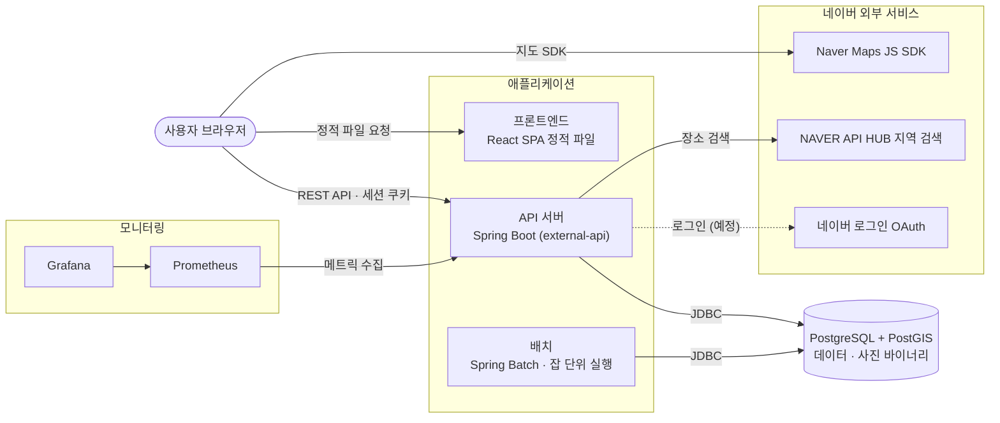
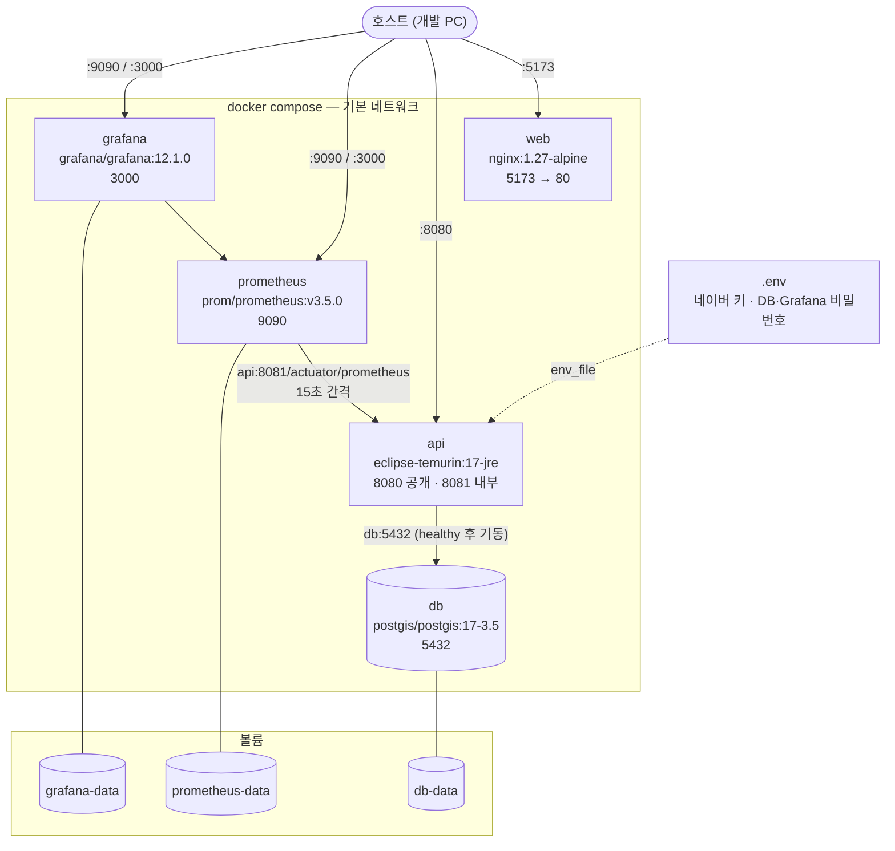
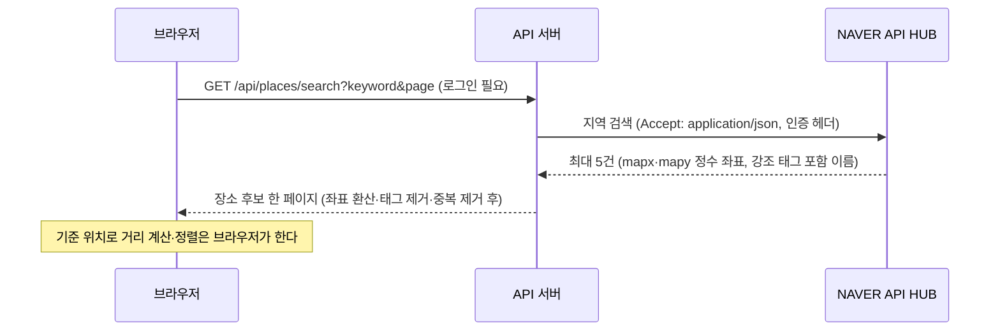

# 아키텍처 구성도

서비스를 이루는 서버·DB·외부 서비스와 그것이 어떤 환경에서 실행되는지를 정리한다.
규칙·정책은 [SPECIFICATION.md](./SPECIFICATION.md)와 모듈 명세가 기준이고, 실행 방법은 각 README 에 있다.

## 1. 전체 구성

| 구성 요소 | 기술 | 역할 |
|---|---|---|
| 프론트엔드 | React 19 · Vite, nginx 로 서빙 | 빌드된 정적 파일. 서버 로직 없음 |
| API 서버 | Kotlin 2.3 · Spring Boot 4.1 · Java 17 | 프론트엔드가 부르는 유일한 서버. 인증·인가·데이터 처리 |
| 배치 | Spring Batch 6 | 로그인 이력 일별 집계·보관 기간 경과분 삭제. 상시 프로세스가 아니라 잡 하나를 돌리고 종료 |
| DB | PostgreSQL 17 + PostGIS 3.5 | 단일 DB. 사진 바이너리도 여기 저장. 스키마는 API 서버의 Flyway 마이그레이션이 관리 |
| 모니터링 | Prometheus · Grafana | API 서버 관리 포트의 메트릭을 수집·시각화 |

- **브라우저가 API 서버를 직접 호출한다.** 프론트엔드 서버는 API 를 프록시하지 않으므로 API 서버가
  CORS 로 프론트엔드 오리진을 허용한다.
- **API 서버와 배치는 같은 DB 를 쓰지만 코드 의존은 없다.** 배치는 엔티티 없이 SQL 로 접근하며,
  메타데이터 테이블 없이 돈다.
- 포트는 API `8080`, 관리(Actuator) `8081`. 관리 포트는 외부에 열지 않는 것을 전제로 한다.

## 2. 구조와 기술 스택을 고른 이유

### 2.1 구조
- **프론트엔드와 API 서버를 나눈다.** 프론트엔드는 빌드된 정적 파일이라 서버 없이 어떤 정적 호스팅에도
  올릴 수 있고, 서버 로직은 API 서버 하나에만 둔다. 브라우저가 API 를 직접 부르므로 API 서버가 CORS 로
  프론트엔드 오리진을 허용한다.
- **배치를 API 서버와 다른 애플리케이션으로 둔다.** 정기 정리 작업은 하루 한 번 돌고 끝나는 일이라 상시
  프로세스가 필요 없고, API 서버의 응답과 자원을 나눠 쓰지 않게 하기 위해서다. 외부 스케줄러가 실행하고
  종료 코드로 실패를 판단한다.
- **DB 는 하나다.** 사진 바이너리도 같은 DB 에 둔다. 별도 파일 저장소를 두면 백업·삭제·트랜잭션 경계가
  둘로 갈리는데, 이 서비스의 사진 규모에서는 그 비용이 더 크다.
- **외부 API 는 API 서버만 부른다.** 네이버 지역 검색은 브라우저 호출(CORS)을 지원하지 않고, 키를
  브라우저에 두면 노출된다. 브라우저가 직접 쓰는 것은 공개 전제인 지도 SDK 하나다.

### 2.2 기술 스택
| 기술 | 고른 이유 |
|---|---|
| Kotlin · Spring Boot | 공개 범위 판정이 이 서비스에서 가장 위험한 지점이라 인증·세션·CSRF·인가를 검증된 프레임워크(Spring Security)에 맡긴다. Kotlin 은 null 안전성과 간결한 DTO 때문이다 |
| Spring Data JPA · Specifications | 범위·정렬·공개 범위 조건을 조합하는 동적 조회가 많고, 공개 범위 판정을 조회 쿼리 단계에서 해야 한다 |
| PostgreSQL + PostGIS | 거리순 정렬을 위치 인덱스(KNN)로 처리한다. 모든 환경을 같은 DB 로 맞춰 테스트와 운영의 동작 차이를 없앤다 |
| Flyway | API 서버와 배치가 같은 DB 를 쓰므로 스키마의 기준을 한 곳(API 서버의 마이그레이션)에 둔다 |
| Spring Batch | 잡 단위 실행·재실행과 실패 판정을 직접 짜지 않는다 |
| Testcontainers | 테스트도 운영과 같은 PostgreSQL + PostGIS 에서 돌려, 다른 DB 를 쓰면 숨는 쿼리 차이를 잡는다 |
| React · Vite · 순수 JavaScript | 화면 수가 많지 않아 TypeScript·전역 상태 라이브러리 없이 충분하다. 결과물이 정적 파일이라 배포가 단순하다 |
| 세션 쿠키 + CSRF 토큰 | 인증 토큰을 HttpOnly 쿠키에 두어 스크립트가 읽을 수 없게 한다 |
| Prometheus · Grafana | 장소 검색이 외부 API 에 의존하므로 호출 수·지연·실패를 지표로 본다 |
| Docker Compose | DB·API·프론트엔드·모니터링을 명령 하나로 같은 구성으로 띄운다 |

## 3. 로컬 실행 환경 — Docker Compose

`compose.yml` 하나로 전체를 띄운다. 모든 컨테이너는 compose 기본 네트워크 하나에 있다.

| 서비스 | 이미지 | 호스트 포트 | 비고 |
|---|---|---|---|
| `db` | `postgis/postgis:17-3.5` | 5432 | `db-data` 볼륨. TCP `pg_isready` 헬스체크 |
| `api` | `./backend` 빌드 (JDK 로 빌드 → JRE 실행 이미지) | 8080 | `local` 프로파일. db 헬스체크 통과 후 기동, Actuator 헬스체크 |
| `web` | `./frontend` 빌드 (Node 로 빌드 → nginx 실행 이미지) | 5173 | 지도 Client ID 는 빌드 인자로 번들에 포함 |
| `prometheus` | `prom/prometheus:v3.5.0` | 9090 | compose 의 `api` 만 수집 |
| `grafana` | `grafana/grafana:12.1.0` | 3000 | 데이터 소스·대시보드 자동 등록 |

- **배치는 compose 에 없다.** 필요할 때 Gradle 또는 jar 로 실행해 같은 DB 에 붙는다. API 이미지에도
  배치 소스는 들어가지 않는다.
- 비밀값은 루트 `.env` 에 두고, 없으면 기본값으로 뜬다.
- 변형 실행
  - 앱만: `docker compose up db api web`
  - 프론트엔드 HMR: `docker compose up db api` + `npm run dev` (5173 이 `web` 과 겹친다)
  - API 를 IDE 로: `docker compose up db` + `./gradlew :external-api:bootRun` — 이때는 Prometheus 수집 대상이 아니다

## 4. 실행 환경별 구성

API 서버와 배치는 Spring 프로파일로 환경을 구분한다.

| 환경 | DB | 스키마 적용 | 로그 |
|---|---|---|---|
| `local` | compose 의 PostgreSQL (기본 접속값 내장) | 기동 시 Flyway + 로컬 시드 | 콘솔 |
| `dev` | 외부 PostgreSQL (환경 변수 주입) | 기동 시 Flyway | 콘솔 |
| `prod` | 외부 PostgreSQL (환경 변수 주입) | 앱은 끔, 배포 절차에서 Flyway CLI | 콘솔 + 롤링 파일 |
| `test` | Testcontainers 가 띄우는 PostGIS 컨테이너 | 기동 시 Flyway | — |

- 모든 환경이 PostgreSQL + PostGIS 이고 `ddl-auto: validate` 다. 스키마와 엔티티가 어긋나면 기동하지 않는다.
- API 서버는 TLS 를 종료하는 리버스 프록시 뒤에 두는 배포를 고려해 프록시 헤더(`X-Forwarded-*`)를
  신뢰하도록 설정되어 있다.
- **dev·prod 의 서버 인프라는 저장소에 정의되어 있지 않다.** 산출물은 API 서버 jar(또는 Docker 이미지),
  배치 jar, 프론트엔드 정적 파일(`dist/`)이며, 정적 파일은 임의의 정적 호스팅에 올릴 수 있다.
  배치는 외부 스케줄러(cron 등)가 매일 잡 이름을 넘겨 실행하고 종료 코드로 실패를 판단하는 구조다.

## 5. 외부 서비스

| 서비스 | 호출 주체 | 용도 |
|---|---|---|
| Naver Maps JS SDK | 브라우저 | 지도 표시 |
| NAVER API HUB 지역 검색 | API 서버 | 장소 검색 |
| 네이버 로그인 OAuth | API 서버 | 로그인 (예정) |

### 5.1 장소 검색 흐름

- 검색 한 번에 외부 API 를 **한 번** 부른다. 원본이 검색어당 5건까지만 주므로 결과도 최대 5건이다.
  후보를 늘리는 검색어 변형 호출은 아직 없다 (설계 전제는 [명세 §4.2](./SPECIFICATION.md)).
- 기준 위치는 서버로 보내지 않는다. 거리순 정렬은 받은 페이지 안에서만 이뤄진다.
- 키는 API 서버에만 있다. 키가 없거나 호출이 실패하면 `PLACE_SEARCH_UNAVAILABLE` 로 실패를 알린다.
- 외부 호출은 `http.client.requests` 지표로 남고, 검색어는 지표 라벨에 남기지 않는다.
