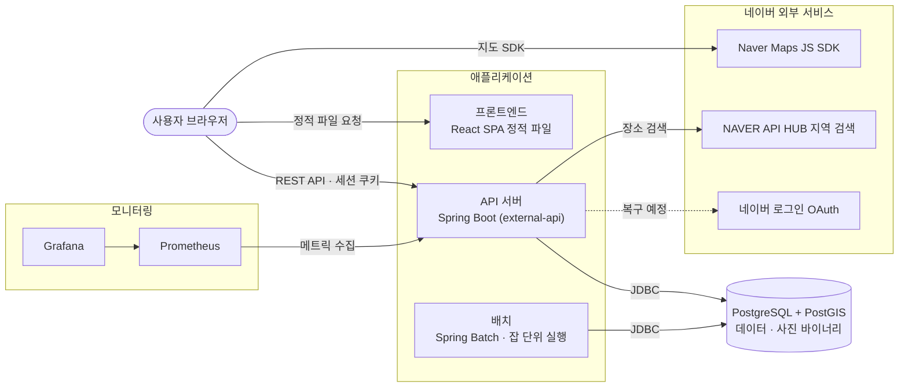

# 아키텍처 구성도

서비스를 이루는 서버·DB·외부 서비스와 그것이 어떤 환경에서 실행되는지를 정리한다.
규칙·정책은 [SPECIFICATION.md](./SPECIFICATION.md)와 모듈 명세가 기준이고, 실행 방법은 각 README 에 있다.

## 1. 전체 구성

| 구성 요소 | 기술 | 역할 |
|---|---|---|
| 프론트엔드 | React 19 · Vite, nginx 로 서빙 | 빌드된 정적 파일. 서버 로직 없음 |
| API 서버 | Kotlin 2.3 · Spring Boot 4.1 · Java 17 | 프론트엔드가 부르는 유일한 서버. 인증·인가·데이터 처리 |
| 배치 | Spring Batch 6 | 로그인 이력 일별 집계·보관 기간 경과분 삭제. 상시 프로세스가 아니라 잡 하나를 돌리고 종료 |
| DB | PostgreSQL 17 + PostGIS 3.5 | 단일 DB. 사진 바이너리도 여기 저장. 스키마는 API 서버의 Flyway 마이그레이션이 관리 |
| 모니터링 | Prometheus · Grafana | API 서버 관리 포트의 메트릭을 수집·시각화 |

- **브라우저가 API 서버를 직접 호출한다.** 프론트엔드 서버는 API 를 프록시하지 않으므로 API 서버가
  CORS 로 프론트엔드 오리진을 허용한다.
- **API 서버와 배치는 같은 DB 를 쓰지만 코드 의존은 없다.** 배치는 엔티티 없이 SQL 로 접근하며,
  메타데이터 테이블 없이 돈다.
- 포트는 API `8080`, 관리(Actuator) `8081`. 관리 포트는 외부에 열지 않는 것을 전제로 한다.

## 2. 로컬 실행 환경 — Docker Compose

`compose.yml` 하나로 전체를 띄운다. 모든 컨테이너는 compose 기본 네트워크 하나에 있다.

| 서비스 | 이미지 | 호스트 포트 | 비고 |
|---|---|---|---|
| `db` | `postgis/postgis:17-3.5` | 5432 | `db-data` 볼륨. TCP `pg_isready` 헬스체크 |
| `api` | `./backend` 빌드 (JDK 로 빌드 → JRE 실행 이미지) | 8080 | `local` 프로파일. db 헬스체크 통과 후 기동, Actuator 헬스체크 |
| `web` | `./frontend` 빌드 (Node 로 빌드 → nginx 실행 이미지) | 5173 | 지도 Client ID 는 빌드 인자로 번들에 포함 |
| `prometheus` | `prom/prometheus:v3.5.0` | 9090 | compose 의 `api` 만 수집 |
| `grafana` | `grafana/grafana:12.1.0` | 3000 | 데이터 소스·대시보드 자동 등록 |

- **배치는 compose 에 없다.** 필요할 때 Gradle 또는 jar 로 실행해 같은 DB 에 붙는다. API 이미지에도
  배치 소스는 들어가지 않는다.
- 비밀값은 루트 `.env` 에 두고, 없으면 기본값으로 뜬다.
- 변형 실행
  - 앱만: `docker compose up db api web`
  - 프론트엔드 HMR: `docker compose up db api` + `npm run dev` (5173 이 `web` 과 겹친다)
  - API 를 IDE 로: `docker compose up db` + `./gradlew :external-api:bootRun` — 이때는 Prometheus 수집 대상이 아니다

## 3. 실행 환경별 구성

API 서버와 배치는 Spring 프로파일로 환경을 구분한다.

| 환경 | DB | 스키마 적용 | 로그인 | 로그 |
|---|---|---|---|---|
| `local` | compose 의 PostgreSQL (기본 접속값 내장) | 기동 시 Flyway + 로컬 시드 | 임시 고정 계정 | 콘솔 |
| `dev` | 외부 PostgreSQL (환경 변수 주입) | 기동 시 Flyway | 임시 고정 계정 | 콘솔 |
| `prod` | 외부 PostgreSQL (환경 변수 주입) | 앱은 끔, 배포 절차에서 Flyway CLI | 없음 (OAuth 복구 전) | 콘솔 + 롤링 파일 |
| `test` | Testcontainers 가 띄우는 PostGIS 컨테이너 | 기동 시 Flyway | — | — |

- 모든 환경이 PostgreSQL + PostGIS 이고 `ddl-auto: validate` 다. 스키마와 엔티티가 어긋나면 기동하지 않는다.
- API 서버는 TLS 를 종료하는 리버스 프록시 뒤에 두는 배포를 고려해 프록시 헤더(`X-Forwarded-*`)를
  신뢰하도록 설정되어 있다.
- **dev·prod 의 서버 인프라는 저장소에 정의되어 있지 않다.** 산출물은 API 서버 jar(또는 Docker 이미지),
  배치 jar, 프론트엔드 정적 파일(`dist/`)이며, 정적 파일은 임의의 정적 호스팅에 올릴 수 있다.
  배치는 외부 스케줄러(cron 등)가 매일 잡 이름을 넘겨 실행하고 종료 코드로 실패를 판단하는 구조다.

## 4. 외부 서비스

| 서비스 | 호출 주체 | 용도 | 현재 상태 |
|---|---|---|---|
| Naver Maps JS SDK | 브라우저 | 지도 표시 | Client ID 가 없으면 "새 창으로 열기" 방식 |
| NAVER API HUB 지역 검색 | API 서버 | 장소 검색 | 백엔드 구현됨, 프론트엔드는 아직 목업 사용 |
| 네이버 로그인 OAuth | API 서버 | 로그인 | 설정만 있고 비활성. 임시 로그인으로 대체 중 |
