# 기능별 시퀀스

현재 구현 기준의 주요 기능 호출 순서. 규칙·권한 판정의 기준은 [공통 명세](./specification.md), 요청·응답
형식과 오류 코드는 [API 명세](./api-specification.md), 화면 동작은 [프론트엔드 명세](./frontend-specification.md).

- 참여자: 브라우저(프론트엔드 SPA), API 서버, DB, NAVER API HUB
- 쓰기 요청: 전부 세션 쿠키 + `X-XSRF-TOKEN` 헤더 (§1)
- 접근 불가: 볼 수 없는 여행·기록은 없는 것과 같은 `404`, 볼 수 있지만 소유자가 아니면 `403`
- 화면 갱신: 쓰기 성공 후 다시 조회. 낙관적 갱신 없음

## 1. 세션 확인과 CSRF 토큰

앱 부팅 시 1회. 쓰기 요청 직전에 토큰이 없으면 다시 받음.

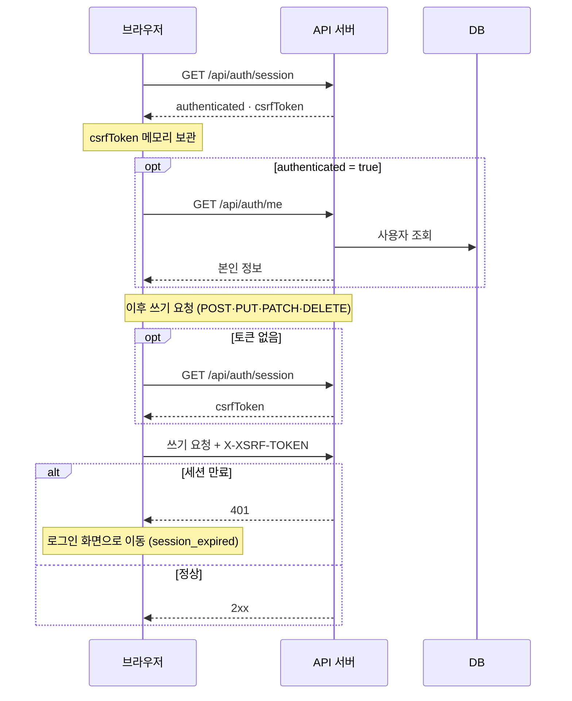

## 2. 로그인·로그아웃

네이버 OAuth 복구 전 임시 로그인 (`local`·`dev` 프로파일 전용 고정 계정).

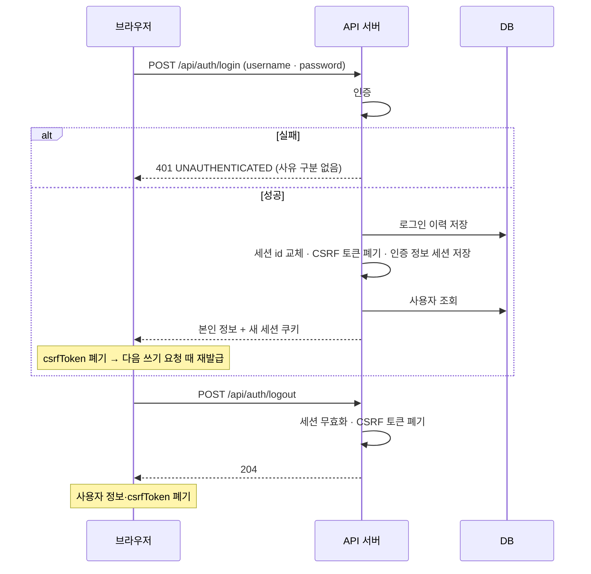

## 3. 여행 만들기

공개 범위 GROUP 선택 시에만 내 그룹 목록 조회.

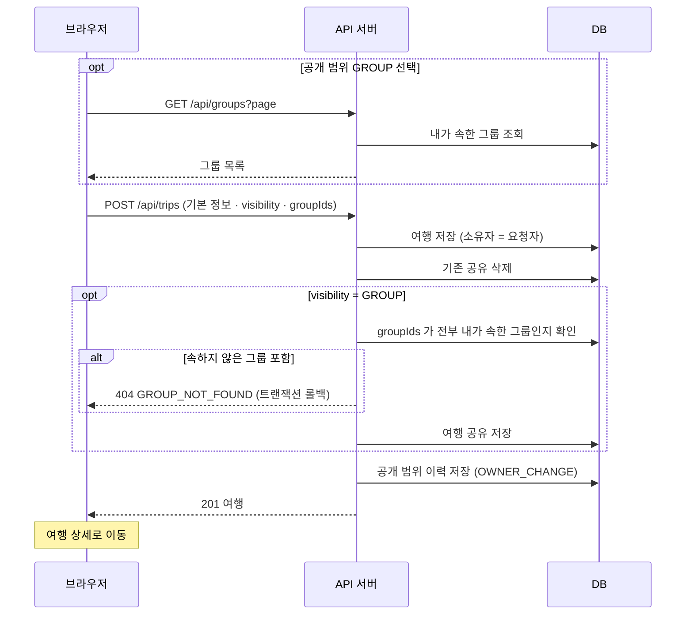

## 4. 여행 상세 조회

비로그인도 PUBLIC 여행 조회 가능.

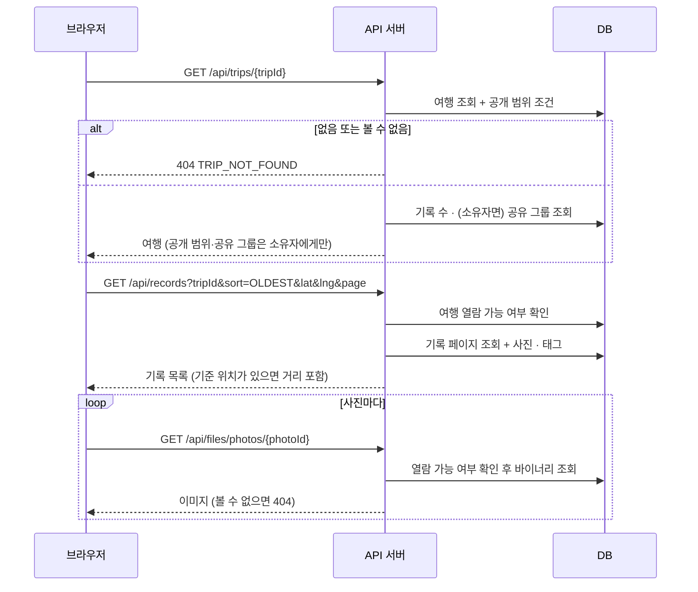

## 5. 여행지(기록) 추가

장소 검색 → 기록 등록 → 사진 업로드. 기록과 사진은 별도 요청이라 사진만 실패할 수 있음.

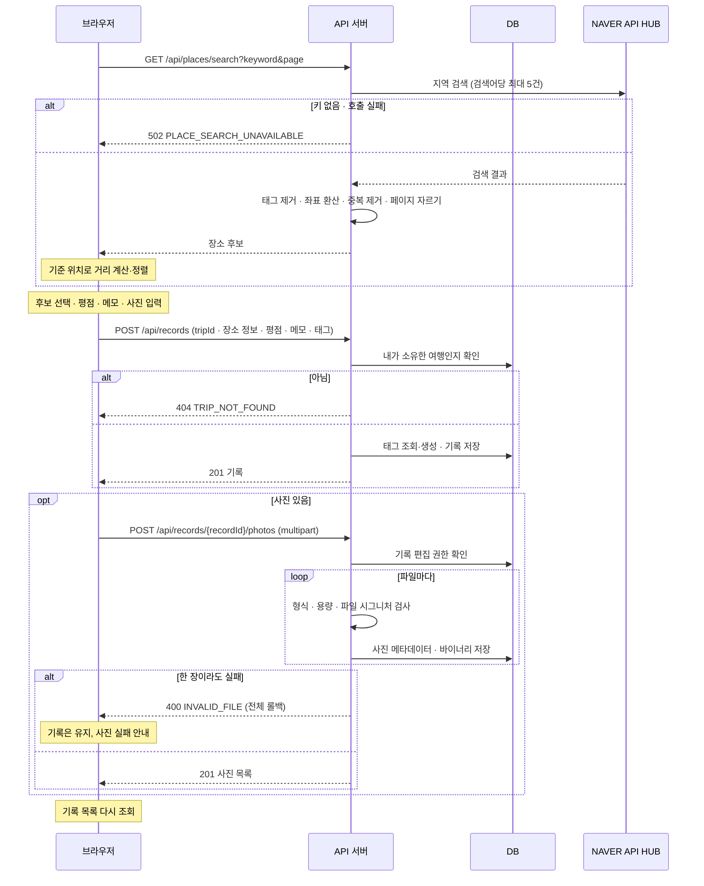

## 6. 여행 공개 범위 변경

소유자 전용. 공유 그룹은 통째로 교체.

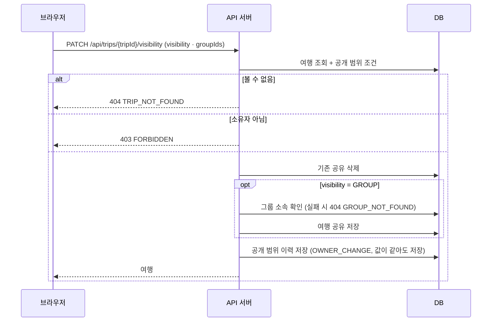

## 7. 여행·기록 삭제

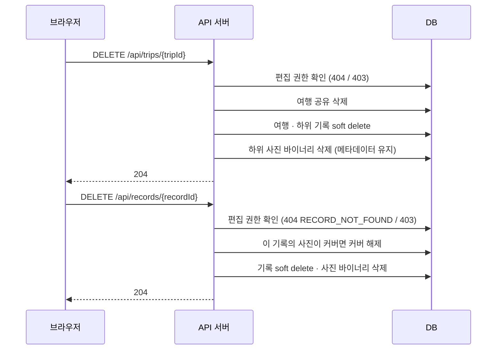

## 8. 그룹 만들기

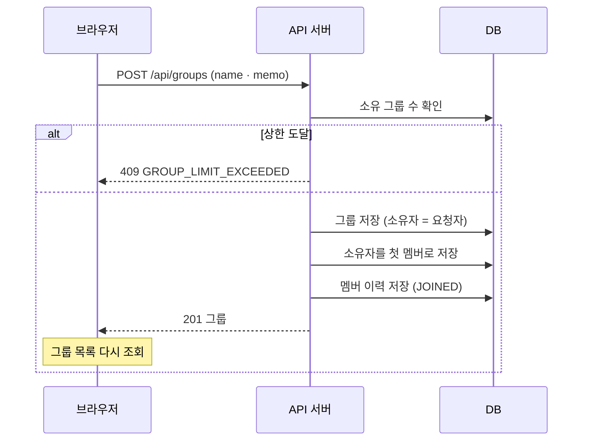

## 9. 초대 보내기·철회

소유자 전용. 이메일로 가입자 지정. 정원은 수락 시점에 확인.

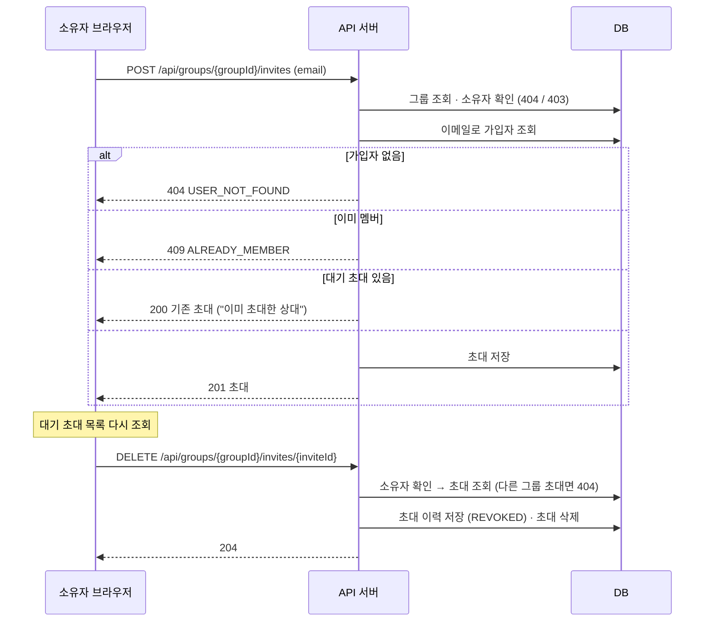

## 10. 초대 수락·거절

받은 사람 전용. 남의 초대는 없는 초대와 같은 `404 INVITE_NOT_FOUND`.

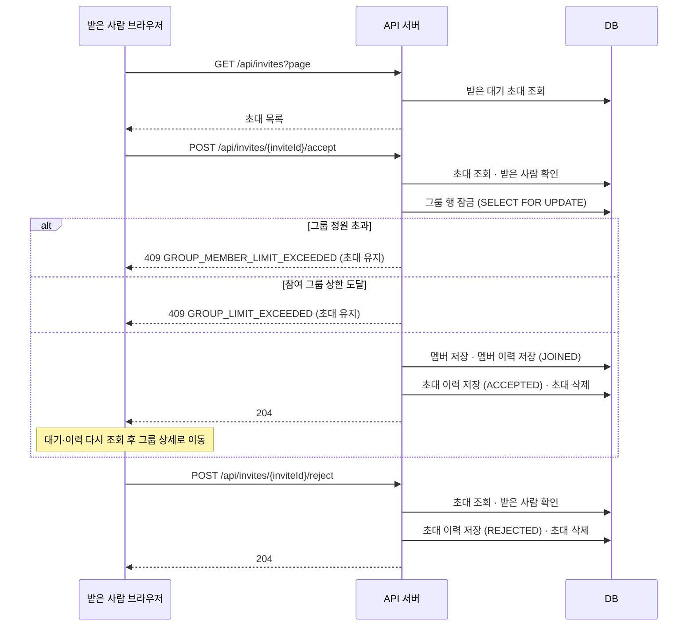

## 11. 그룹 탈퇴·멤버 제외·그룹 삭제

멤버십이 끝나면 그 멤버가 이 그룹에 건 여행 공유도 해제. 여행의 공개 범위 값은 GROUP 유지.

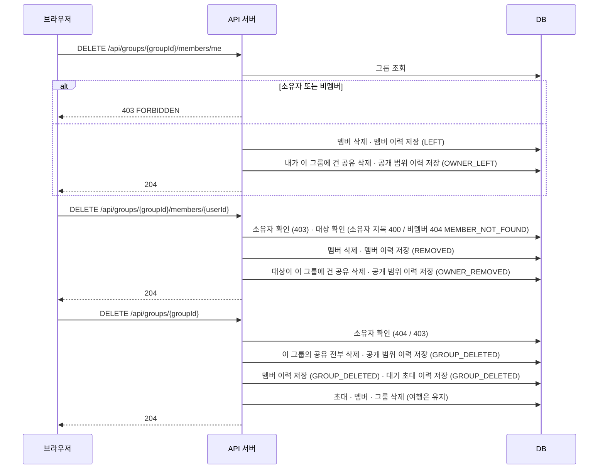
